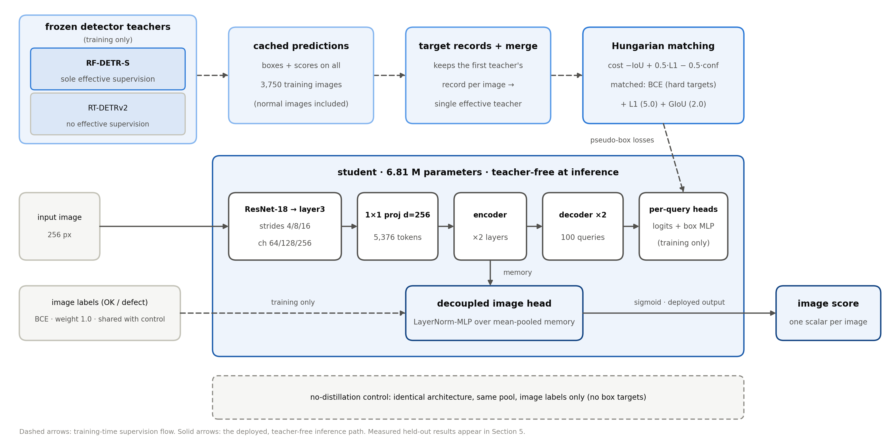

# detector-to-scout-distillation

Companion code for the paper:

> **Boxes to Scores: Distilling Box-Supervised Defect Detectors into Compact Image-Level Anomaly Scouts**

## 1. What this is

Industrial inspection lines ultimately need one image-level decision — pass or flag — yet the most
accurate defect models are box-supervised detectors: annotation-hungry to train and larger than the
deployment slot they must fill. This repository implements the paper's recipe for transferring the
knowledge inside such a detector **across tasks**: from box-level detection into a compact student
that outputs only an image-level anomaly score and runs without its teacher.

The pipeline has three stages, and this repo ships one command per stage:

```
your detector (any) ──run once──▶ predictions JSONL          (outside this repo)
                                        │
                       [1] build_targets.py                  cached predictions → per-image
                                        │                    pseudo-box target records
                                        ▼
                       [2] train.py                          Hungarian matching assigns targets to
                                        │                    the student's 100 queries; matched-query
                                        │                    losses + image-label BCE train the
                                        │                    compact multi-scale student
                                        ▼
                       [3] infer.py / export_onnx.py         teacher-free deployment: one forward
                                                             pass, one scalar score
```



The student ("RT-Scout") is a 6.81 M-parameter multi-scale transformer: a truncated ResNet-18
backbone (strides 4/8/16), a 2-layer encoder over 5,376 tokens, a 2-layer decoder over 100 queries,
and — the deployed output — a *decoupled image head* whose sigmoid over the mean-pooled encoder
memory is the image-level anomaly score. The per-query class/box heads exist to consume the
distillation losses; they are training scaffolding, not deployed outputs.

Everything here mirrors the implementation actually measured in the paper (Section 3, "as
implemented"), including two facts a cleaner idealisation would hide: the classification targets
are **hard** pseudo-boxes (teacher confidences are stored but not propagated into the loss), and
the paper's two-teacher merge was **first-seen-wins** (effectively single-teacher; see §4 below).

## 2. Install

```bash
python -m venv .venv && source .venv/bin/activate
pip install -r requirements.txt
```

Requirements: Python ≥ 3.10, `torch`, `timm`, `scipy`, `numpy`, `pyyaml`, `pillow`, plus `onnx` /
`onnxruntime` for export. A CUDA GPU is strongly recommended for training (the paper's 30k-step
recipe); `--device cuda` fails loudly if no GPU is reachable — there is no silent CPU fallback.

Quick end-to-end smoke test (synthetic data, ~20 training steps):

```bash
python examples/make_dummy_dataset.py --out /tmp/scout_dummy
python -m detector_to_scout.build_targets \
    --manifest /tmp/scout_dummy/train.jsonl \
    --predictions /tmp/scout_dummy/teacher_predictions.jsonl \
    --teacher synthetic_teacher \
    --out /tmp/scout_dummy/targets/teacher_targets.jsonl
python -m detector_to_scout.train \
    --config /tmp/scout_dummy/smoke_config.yaml \
    --run-dir /tmp/scout_dummy/run --max-steps 20 --device cuda
python -m detector_to_scout.infer \
    --checkpoint /tmp/scout_dummy/run/final_state.pt \
    --manifest /tmp/scout_dummy/val.jsonl --device cuda --out /tmp/scout_dummy/scores.jsonl
python -m detector_to_scout.export_onnx \
    --checkpoint /tmp/scout_dummy/run/final_state.pt \
    --out /tmp/scout_dummy/rt_scout.onnx --verify
```

## 3. Data + teacher contract

No datasets are included. You bring (a) images with binary normal/defective labels and (b) a
box-supervised detector's predictions over the **training** images.

### 3.1 Images manifest (JSONL)

One record per image, in `train.jsonl` / `val.jsonl`:

```json
{"image_id": "grid_0001", "image_path": "images/grid_0001.png", "label": "ok"}
{"image_id": "grid_0107", "image_path": "images/grid_0107.png", "label": "nok"}
```

* `image_path` — absolute, or relative (resolved against the CWD first, then against the manifest
  file's directory).
* `label` — `"ok"` (normal) or `"nok"` (defective). This is the binary label consumed by the
  image-level BCE term.
* `image_id` — optional (defaults to `image_path`); must match the id used in the targets JSONL.

**MVTec-AD pointer.** The paper's experiments use [MVTec AD](https://www.mvtec.com/company/research/datasets/mvtec-ad)
(download it yourself; check its license). Build manifests by walking the category folders: `good`
images → `"ok"`, defect images → `"nok"`. **Do not train on MVTec-AD's official test split if you
plan to evaluate on it** — see the leakage warning below.

**Custom datasets.** Any image folder works: write the two manifest files, keep a held-out val/test
split that never enters training, and make sure `label` is filled for every record (the image-level
BCE needs it; the paper's teachers emit boxes on *every* image, so box presence carries no label
information).

### 3.2 Teacher-predictions contract (JSONL) — any detector can be the teacher

Run your detector once over the **training images only** and dump one JSON object per line:

```json
{"image_path": "images/grid_0107.png",
 "boxes": [{"xyxy": [412.0, 105.5, 468.2, 160.0], "score": 0.93, "label": 0}]}
```

Field by field:

| Field | Required | Meaning |
|---|---|---|
| `image_path` | yes | must match the manifest's `image_path` (or provide a matching `image_id`) |
| `image_id` | no | alignment key when present; defaults to `image_path` |
| `boxes` | yes (may be `[]`) | the detector's predictions for this image |
| `boxes[].xyxy` | one of xyxy/cxcywh | `[x0, y0, x1, y1]`, absolute pixels in the ORIGINAL image |
| `boxes[].cxcywh` | one of xyxy/cxcywh | `[cx, cy, w, h]` normalized to `[0, 1]` by original width/height; conversion needs the image size — add `width`/`height` fields to the record, or the script opens the image to read them |
| `boxes[].score` | yes | confidence in `[0, 1]` (clamped). Stored for provenance; the trainer supervises matched queries with hard 1.0 targets (paper §3.2) |
| `boxes[].label` | no | class id (int or str); stored, not used by the loss — the student is class-agnostic |

Keep low-confidence boxes: do **not** threshold the teacher's output. One structural property of
the paper's targets is that detector teachers emit boxes on every image, defective and normal
alike — normal images receive low-confidence teacher boxes rather than empty target sets, so the
target signal is dense precisely where ground-truth supervision would be background-only.

**Adapter note — RF-DETR-style outputs** (normalized `cxcywh` + per-box confidence):

```python
rec = {"image_path": path, "width": W, "height": H,
       "boxes": [{"cxcywh": [float(v) for v in b], "score": float(s), "label": int(c)}
                 for b, s, c in zip(pred_boxes, pred_scores, pred_labels)]}
```

**Adapter note — RT-DETR / COCO-style outputs** (absolute `[x, y, w, h]` pixel boxes, e.g. COCO
detection dumps):

```python
rec = {"image_path": path,
       "boxes": [{"xyxy": [x, y, x + w, y + h], "score": float(s), "label": int(c)}
                 for (x, y, w, h), s, c in dets]}
```

### 3.3 Leakage warning (read this twice)

Build teacher predictions and targets for **TRAINING images only**. Never let evaluation images —
or their teacher predictions — into the training pool or the targets file. `build_targets.py`
filters predictions down to the images present in the `--manifest` you pass it, so passing your
*train* manifest is the guard; passing a manifest that contains eval images defeats it. A score
measured on a surface the model trained on is invalid.

### 3.4 Building the targets

```bash
python -m detector_to_scout.build_targets \
    --manifest data/train.jsonl \
    --predictions teacher_predictions.jsonl \
    --teacher my_detector \
    --out targets/teacher_targets.jsonl
```

Single-teacher is the default. Multiple `--predictions` files require the explicit
`--merge first-seen-wins` flag (see §4). Images in the manifest without a teacher record are
trained with background-only supervision (every query pushed toward background).

## 4. Reproducing the paper's training

The paper recipe, verbatim (`configs/distill_default.yaml`):

| Knob | Value |
|---|---|
| steps | 30,000 |
| batch size | 16 |
| optimizer | AdamW, lr 1e-4, weight decay 1e-4 |
| precision | fp32 |
| input | 256 px letterboxed (aspect-preserving, zero-padded, centered), pixel values in `[0, 1]`, **no ImageNet mean/std normalization** |
| seed | 1337 |
| loss weights | class BCE 1.0 · box L1 5.0 · GIoU 2.0 · image-BCE 1.0 |
| matching | Hungarian (scipy `linear_sum_assignment`), cost `-IoU + 0.5·L1 - 0.5·confidence` |
| grad clip | global norm 1.0 |
| backbone init | ImageNet-pretrained (timm) |

```bash
python -m detector_to_scout.train \
    --config configs/distill_default.yaml \
    --teacher-targets targets/teacher_targets.jsonl \
    --run-dir runs/distill_seed1337 \
    --device cuda
```

**Honest note on the paper's teacher merge.** The paper's measured runs merged two teachers'
target files (RF-DETR-S first, RT-DETRv2 second) with a *first-seen-wins* policy: per image, the
first teacher's record is kept wherever both provide one. Because the first teacher's records
covered every training image, the second teacher contributed **no effective supervision** — the
recipe, as implemented and as measured, is effectively single-teacher with the stronger detector
as the sole source of targets (paper §3.2). This repo therefore makes single-teacher the default;
the multi-teacher path exists behind the explicit `--merge first-seen-wins` flag and reproduces
the paper's behaviour honestly:

```bash
python -m detector_to_scout.build_targets \
    --manifest data/train.jsonl \
    --predictions teacher_a_predictions.jsonl \
    --predictions teacher_b_predictions.jsonl \
    --merge first-seen-wins \
    --teacher teacher_a_plus_b \
    --out targets/merged_targets.jsonl
```

Per-teacher and true-union ablations are future work (paper §9); no other merge policy is
implemented.

Two more as-implemented details the trainer mirrors exactly:

* **Hard classification targets.** Matched queries are supervised toward 1.0, not toward the
  teacher's confidence — the confidences sit in the target records but are not propagated into the
  loss. The algorithm is Hungarian-matched pseudo-box supervision, not soft-logit distillation
  (the paper concedes this mechanical reduction explicitly, §7).
* **Image label from the manifest, never from box presence.** Since teachers emit boxes on every
  image, a box-presence label would collapse to a constant 1 and degenerate the image head.

## 5. Fine-tuning on a NEW production dataset

The recipe transfers to any dataset where you can get box-level detector predictions over the
training pool. The paper's controlled comparison is the reason to bother: the distilled student
beat the *identical architecture trained on the same pool's image labels alone* by **+0.050 and
+0.029 AUROC** on the two measured control seeds (0.9614 vs 0.9114 at seed 1337 and 0.9320 at seed
2027) — five and about three times the pre-registered 0.01 indistinguishability bar, with paired
bootstrap 95% CIs of [0.030, 0.071] and [0.010, 0.048] over the shared 802-image evaluation
surface. AUPR margins were larger still (+0.101 / +0.071). More image-label data alone did not
close the gap; the box-level teacher targets are the variable that moves the needle. (Caveat: the
distilled student itself is a single-seed measurement; see paper §7/§9.)

Step by step:

1. **Get a detector teacher.** Either (a) train/deploy a detector on whatever box annotations you
   have for this dataset (any detector — RF-DETR, RT-DETR, YOLO, Faster R-CNN…), or (b) reuse a
   pretrained defect detector from a related product/line. The teacher's quality upper-bounds what
   the student can absorb.
2. **Run the teacher over the OK+NOK training images** (training split only — §3.3) and dump the
   predictions in the contract of §3.2. Do not threshold the scores.
3. **Build targets:**

   ```bash
   python -m detector_to_scout.build_targets \
       --manifest data/new_dataset/train.jsonl \
       --predictions new_dataset_teacher_predictions.jsonl \
       --teacher my_line_detector \
       --out targets/new_dataset_targets.jsonl
   ```

4. **Distill.** Either from scratch (paper recipe, §4) or warm-started from a prior scout
   checkpoint with `--init-checkpoint` (loads model weights only; optimizer and step counter start
   fresh — `configs/finetune_example.yaml` has a shorter schedule and halved lr for this):

   ```bash
   python -m detector_to_scout.train \
       --config configs/finetune_example.yaml \
       --teacher-targets targets/new_dataset_targets.jsonl \
       --init-checkpoint runs/distill_seed1337/final_state.pt \
       --run-dir runs/finetune_new_dataset \
       --device cuda
   ```

5. **Calibrate the operating threshold on a val split** (never on the test split). The training
   objective gives you a score in `[0, 1]`; where you cut it is a business decision about the
   false-alarm / missed-defect trade-off. A minimal calibration snippet (max-Youden and max-F1):

   ```python
   import json
   import numpy as np

   preds = [json.loads(l) for l in open("runs/finetune_new_dataset/predictions.jsonl")]
   val = {json.loads(l)["image_id"]: json.loads(l)["label"] for l in open("data/new_dataset/val.jsonl")}
   y = np.array([1 if val[p["image_id"]] == "nok" else 0 for p in preds])
   s = np.array([p["image_score"] for p in preds])

   taus = np.unique(s)
   best = {"youden": (None, -1.0), "f1": (None, -1.0)}
   for tau in taus:
       yhat = (s >= tau).astype(int)
       tp = int(((yhat == 1) & (y == 1)).sum()); fp = int(((yhat == 1) & (y == 0)).sum())
       fn = int(((yhat == 0) & (y == 1)).sum()); tn = int(((yhat == 0) & (y == 0)).sum())
       tpr = tp / max(tp + fn, 1); fpr = fp / max(fp + tn, 1)
       youden = tpr - fpr
       f1 = 2 * tp / max(2 * tp + fp + fn, 1)
       if youden > best["youden"][1]: best["youden"] = (float(tau), youden)
       if f1 > best["f1"][1]: best["f1"] = (float(tau), f1)
   print("tau* (Youden):", best["youden"], " tau* (F1):", best["f1"])
   ```

   Report threshold-free AUROC/AUPR alongside any thresholded operating point, and keep the
   calibration split disjoint from the final test split.

## 6. Retraining commands (worked examples)

```bash
# (a) Paper recipe from scratch, seed 1337 (edit manifests in the config first)
python -m detector_to_scout.train --config configs/distill_default.yaml \
    --teacher-targets targets/teacher_targets.jsonl \
    --run-dir runs/distill_seed1337 --device cuda

# (b) Different seed (everything else identical)
python -m detector_to_scout.train --config configs/distill_default.yaml \
    --teacher-targets targets/teacher_targets.jsonl \
    --run-dir runs/distill_seed2027 --seed 2027 --device cuda

# (c) Short pilot run (2,000 steps) to sanity-check a new dataset
python -m detector_to_scout.train --config configs/distill_default.yaml \
    --teacher-targets targets/teacher_targets.jsonl \
    --run-dir runs/pilot --max-steps 2000 --device cuda

# (d) Warm-started fine-tune on a new dataset
python -m detector_to_scout.train --config configs/finetune_example.yaml \
    --teacher-targets targets/new_dataset_targets.jsonl \
    --init-checkpoint runs/distill_seed1337/final_state.pt \
    --run-dir runs/finetune_new_dataset --device cuda

# (e) Resume an interrupted run (restores model+optimizer+RNG+step)
python -m detector_to_scout.train --config configs/distill_default.yaml \
    --teacher-targets targets/teacher_targets.jsonl \
    --run-dir runs/distill_seed1337 --resume-from runs/distill_seed1337/last_state.pt \
    --device cuda
```

Each run writes into `--run-dir`: `train_log.jsonl` (per-step losses + matching stats),
`last_state.pt` (periodic resume checkpoint), `final_state.pt` (weights + build params),
`predictions.jsonl` (val scores), `metrics.json` (image AUROC), `summary.json` (resolved recipe).

## 7. Inference

### 7.1 Preprocessing spec (must match training bit-for-bit)

1. Aspect-preserving resize so the longer side equals 256 px (bilinear).
2. Zero-pad to 256×256, centered (letterbox).
3. Scale pixel values to `[0, 1]` (divide by 255), channels-first float32.
4. **No ImageNet mean/std normalization.** The as-measured pipeline never applies it — do not add
   it, even though the backbone was ImageNet-initialised.

`infer.py` and `ScoutPredictor` do all of this for you; if you feed the ONNX model yourself, you
must replicate it (see `detector_to_scout.model.letterbox_infer`).

### 7.2 PyTorch CLI + API

```bash
python -m detector_to_scout.infer \
    --checkpoint runs/distill_seed1337/final_state.pt \
    --images line_cam_001.png line_cam_002.png \
    --device cuda --out scores.jsonl --include-boxes
```

```python
from detector_to_scout.infer import ScoutPredictor

predictor = ScoutPredictor("runs/distill_seed1337/final_state.pt", device="cuda")
result = predictor.score_image("line_cam_001.png")
print(result["image_score"])   # float in [0, 1] — the deployed output
print(result["boxes"])         # optional diagnostics (letterboxed-canvas pixel coords)
```

The deployed output is `image_score` — the sigmoid of the decoupled image head. The per-query
boxes are training scaffolding surfaced for diagnostics only; at inference the student runs
teacher-free: one forward pass, one scalar score.

### 7.3 ONNX export + onnxruntime

```bash
python -m detector_to_scout.export_onnx \
    --checkpoint runs/distill_seed1337/final_state.pt \
    --out runs/distill_seed1337/rt_scout.onnx \
    --verify
```

Export details: **opset 17**, **dynamic batch** dimension on the input and all outputs. The graph
exports the image-score path *and* the per-query boxes: outputs are `image_score (B,)`,
`query_scores (B, 100)`, `query_boxes (B, 100, 4)` (normalized cxcywh; multiply by 256 for
letterboxed-canvas pixels). Preprocessing happens outside the graph.

```python
import numpy as np
import onnxruntime as ort
from detector_to_scout.model import letterbox_infer
from PIL import Image

sess = ort.InferenceSession("runs/distill_seed1337/rt_scout.onnx",
                            providers=["CUDAExecutionProvider", "CPUExecutionProvider"])
canvas, _ = letterbox_infer(np.asarray(Image.open("line_cam_001.png").convert("RGB")), target=256)
x = np.transpose(canvas, (2, 0, 1))[None].astype(np.float32)   # (1, 3, 256, 256)
image_score, query_scores, query_boxes = sess.run(None, {"images": x})
print(float(image_score[0]))
```

**Parity warning.** Always run `--verify` (asserts `|torch − onnx| < 1e-4` element-wise at batch
sizes 1 and 4) after every export, and re-verify after changing torch/onnx/onnxruntime versions.
Small numeric drift is expected across runtimes; drift ≥ 1e-4 on the image score means something
is wrong (wrong opset, fp16 conversion, modified graph) — do not deploy an unverified export.

**Edge deployment note.** The student is compact: **6,814,165 checkpoint tensor elements
(6.81 M, buffers included — the paper's counting convention, ~26 MB in fp32)**, computed from the
instantiated model via `RTScout.count_parameters()`. That is ~4.7× fewer than the RF-DETR-S
teacher (31.8 M) and ~3.0× fewer than RT-DETRv2 (20.5 M). Single-input single-output (if you drop
the diagnostic heads at integration time), fixed 256×256 input, no teacher at runtime — it fits
comfortably on Jetson-class edge devices via onnxruntime or TensorRT (engine conversion from the
ONNX file is standard; re-verify parity after conversion).

## 8. Repo layout + troubleshooting

```
detector-to-scout-distillation/
├── detector_to_scout/
│   ├── __init__.py          # package exports
│   ├── model.py             # RT-Scout student, losses, Hungarian matching, letterbox
│   ├── data.py              # manifests, targets, training-side letterbox, batch builder
│   ├── build_targets.py     # [stage 1] teacher predictions JSONL → targets JSONL
│   ├── train.py             # [stage 2] distillation training + val AUROC
│   ├── infer.py             # [stage 3] PyTorch scoring CLI + ScoutPredictor API
│   └── export_onnx.py       # [stage 3] ONNX export (opset 17, dynamic batch) + parity check
├── configs/
│   ├── distill_default.yaml # the paper recipe
│   └── finetune_example.yaml
├── examples/
│   └── make_dummy_dataset.py  # synthetic images + synthetic teacher predictions
├── docs/
│   └── distillation_schematic.{png,pdf}
├── requirements.txt
├── README.md
├── .gitignore
└── LICENSE                  # License: TBD by the authors
```

**Troubleshooting**

| Symptom | Likely cause / fix |
|---|---|
| `--device cuda requested but no GPU is reachable` | No CUDA device visible to torch. Fix the driver/container (e.g. restart the container after a host driver update); the tool never silently falls back to CPU. |
| `image not found: ...` at training start | Manifest `image_path` doesn't resolve. Paths are tried absolute → CWD-relative → manifest-dir-relative. |
| `multiple --predictions files require an explicit --merge first-seen-wins` | You passed several teachers without opting into the paper's merge policy. Read §4 before doing so. |
| Every training image reports `n_matched=0` | Targets JSONL `image_id`s don't match the manifest's. `build_targets.py` canonicalises ids to the manifest's — rebuild targets with the same manifest you train with. |
| Val AUROC is `null` | Your val manifest has only one class (`ok` or `nok`); AUROC needs both. |
| `cxcywh` boxes land in the wrong place | `cxcywh` must be normalized to `[0, 1]` by the ORIGINAL image size. Pixel-space centers must be converted to `xyxy` instead (see the COCO adapter note in §3.2). |
| ONNX parity assert fails | Version drift or a modified graph. Re-export with `--opset 17`, verify torch/onnxruntime versions, and check you did not add normalization to the preprocessing. |
| Scores cluster near 0.5 after very short runs | Expected: the image head starts from a balanced 0.0-bias init; discrimination emerges over thousands of steps (the paper recipe is 30k). |
| scipy missing | The matcher falls back to greedy matching with a warning. Results will differ from the paper — install scipy for exact reproduction. |
