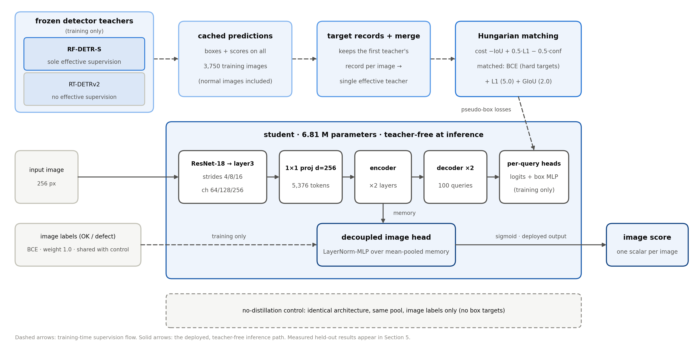

# Detector-to-Scout Distillation

This repository is the companion code of the paper *Boxes to Scores: Distilling Box-Supervised Defect Detectors into Compact Image-Level Anomaly Scouts*: it turns a detector's cached predictions into pseudo-box targets, distills them into a compact student (RT-Scout, 6.81 M parameters) that outputs one image-level anomaly score, and runs that student in PyTorch or ONNX without the teacher.



*Figure 1 of the paper: the pipeline as implemented.*

Read the paper: [Boxes to Scores (PDF)](./paper.pdf).

The pipeline has three stages, one command each:

1. **Targets.** You run your detector once over the training images and save its predictions as JSONL. `build_targets` turns them into one target record per image: the predicted boxes and their confidences. No detector is loaded by this repository.
2. **Distillation.** `train` matches each image's target boxes to the student's 100 queries with the Hungarian algorithm and trains the student on the matched-query losses plus a binary cross-entropy against the image's OK/NOK label.
3. **Deployment.** `infer` and `export_onnx` run the student alone: one forward pass, one score in `[0, 1]`, higher meaning more likely defective.

Two details of the paper's implementation are kept as they were measured: matched queries learn toward a hard target of 1.0 (the teacher's confidences are stored but not used by the loss), and when several teachers are merged, the first one's record for an image wins.

## Installation

```bash
git clone https://github.com/rosepetal-ai/rosepetal-research-detector-to-scout-distillation.git
cd rosepetal-research-detector-to-scout-distillation

python -m venv .venv && source .venv/bin/activate
pip install -r requirements.txt
```

The package is not installed with pip: run its tools from the repository root as `python -m detector_to_scout.<tool>`, or put the root on `PYTHONPATH` to import it.

## Requirements

- Python 3.10 or newer.
- The packages of `requirements.txt`: `torch>=2.1`, `timm>=0.9`, `scipy>=1.10`, `numpy>=1.24`, `pyyaml>=6.0`, `pillow>=9.0`, and for ONNX `onnx>=1.14` and `onnxruntime>=1.16`. Without SciPy the matching falls back to a greedy algorithm and the results will differ from the paper.
- A CUDA GPU for training: the paper recipe is 30,000 steps. Inference also runs on the CPU.
- Network access the first time a model is built with `pretrained: true` (the paper recipe): `timm` downloads the ImageNet weights of ResNet-18 once.
- Your own data: images with OK/NOK labels and a box-supervised detector's predictions over the training images. Neither a dataset nor a detector is included; the paper uses [MVTec AD](https://www.mvtec.com/company/research/datasets/mvtec-ad).

## Documentation

| Page | Contents |
|------|----------|
| [Data and targets](./data.md) | The image manifests, the teacher-predictions format, adapters for common detectors, building the targets, merging teachers |
| [Training](./training.md) | The paper recipe, configuration keys and options, run outputs, resuming, fine-tuning, the student and its loss |
| [Inference and export](./inference.md) | Preprocessing, scoring with PyTorch, ONNX export and parity check, choosing an operating threshold |
| [Paper results](./results.md) | What the paper measured, under which protocol, with its limits |

## Usage

### Smoke test

To try the whole chain on synthetic data (no download; the generated configuration builds the backbone without ImageNet weights):

```bash
python examples/make_dummy_dataset.py --out data/dummy
python -m detector_to_scout.build_targets \
    --manifest data/dummy/train.jsonl \
    --predictions data/dummy/teacher_predictions.jsonl \
    --teacher synthetic_teacher \
    --out data/dummy/targets/teacher_targets.jsonl
python -m detector_to_scout.train \
    --config data/dummy/smoke_config.yaml \
    --run-dir data/dummy/run --max-steps 20 --device cuda
python -m detector_to_scout.infer \
    --checkpoint data/dummy/run/final_state.pt \
    --manifest data/dummy/val.jsonl --device cuda --out data/dummy/scores.jsonl
python -m detector_to_scout.export_onnx \
    --checkpoint data/dummy/run/final_state.pt \
    --out data/dummy/rt_scout.onnx --verify
```

Without a GPU, use `--device cpu`.

### Data

Write a training and a validation manifest, one JSON object per image with its path and an `ok` or `nok` label:

```json
{"image_id": "grid_0001", "image_path": "images/grid_0001.png", "label": "ok"}
{"image_id": "grid_0107", "image_path": "images/grid_0107.png", "label": "nok"}
```

Then run your detector over the **training images only**, without a confidence threshold, and save one line per image:

```json
{"image_path": "images/grid_0107.png",
 "boxes": [{"xyxy": [412.0, 105.5, 468.2, 160.0], "score": 0.93, "label": 0}]}
```

[Data and targets](./data.md) has the full format, adapters for RF-DETR-style and COCO-style outputs, and the leakage rules.

### Targets

```bash
python -m detector_to_scout.build_targets \
    --manifest data/train.jsonl \
    --predictions teacher_predictions.jsonl \
    --teacher my_detector \
    --out targets/teacher_targets.jsonl
```

Only predictions for images of the manifest are kept, so passing the training manifest keeps evaluation images out of the targets.

### Training

Set `manifests.train` and `manifests.val` in `configs/distill_default.yaml` (the paper recipe: 30,000 steps, batch size 16, AdamW with learning rate 1e-4, seed 1337), then:

```bash
python -m detector_to_scout.train \
    --config configs/distill_default.yaml \
    --teacher-targets targets/teacher_targets.jsonl \
    --run-dir runs/distill_seed1337 \
    --device cuda
```

During the run, each step adds a line to `train_log.jsonl`; at the end the run scores the validation images and writes `final_state.pt`, `predictions.jsonl`, `metrics.json` (validation image AUROC) and `summary.json` to the run folder.

### Inference

```bash
python -m detector_to_scout.infer \
    --checkpoint runs/distill_seed1337/final_state.pt \
    --images line_cam_001.png line_cam_002.png \
    --device cuda --out scores.jsonl

python -m detector_to_scout.export_onnx \
    --checkpoint runs/distill_seed1337/final_state.pt \
    --out runs/distill_seed1337/rt_scout.onnx \
    --verify
```

The score is threshold-free: choose the operating threshold on a validation set, as [Inference and export](./inference.md#choosing-a-threshold) shows.

## Results

The paper trains one model for all 15 categories of MVTec AD and scores it on one held-out set of 802 images (614 normal, 188 defective), so its numbers are not comparable with per-category leaderboards.

- The distilled student reaches an image AUROC of **0.9614**. The same architecture trained on the same 3,750 images with their image labels only reaches 0.9114 and 0.9320 at two seeds: the margins (+0.050 and +0.029) exceed the paper's pre-registered bar of 0.01, so the box-level teacher targets, not more image labels, carry the gain.
- It keeps 96.4 % of the AUROC of its strongest teacher, RF-DETR-S (0.9977), with about 4.7 times fewer parameters (6.81 M against 31.8 M), and scores above the second teacher, RT-DETRv2 (0.9344, 20.5 M).
- The student is a single training run on one benchmark, its latency was not measured, and the checkpoints that generated its targets were trained on a split that contains 711 of the 802 evaluation images. [Paper results](./results.md) lists every measurement with its protocol and limits.

The repository does not include the teachers, their predictions, the paper's image pools or any trained checkpoint.

## License

The repository's `LICENSE` file reads: "License: TBD by the authors. No license is granted until the authors select and publish one."
